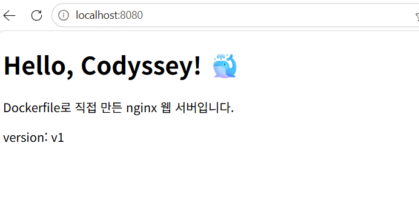
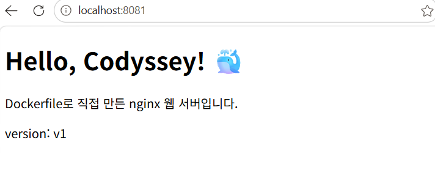
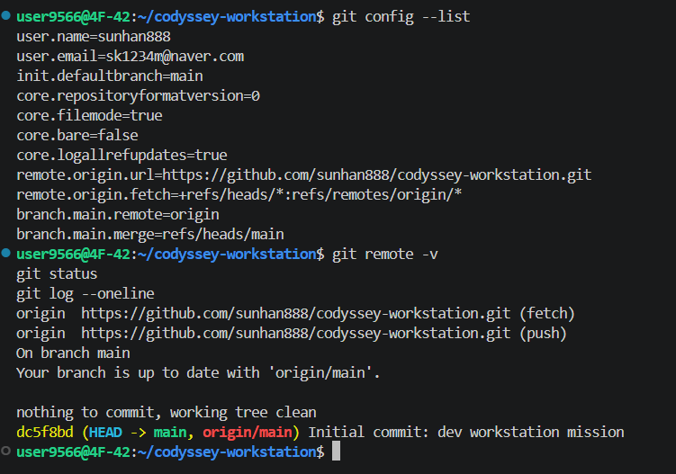
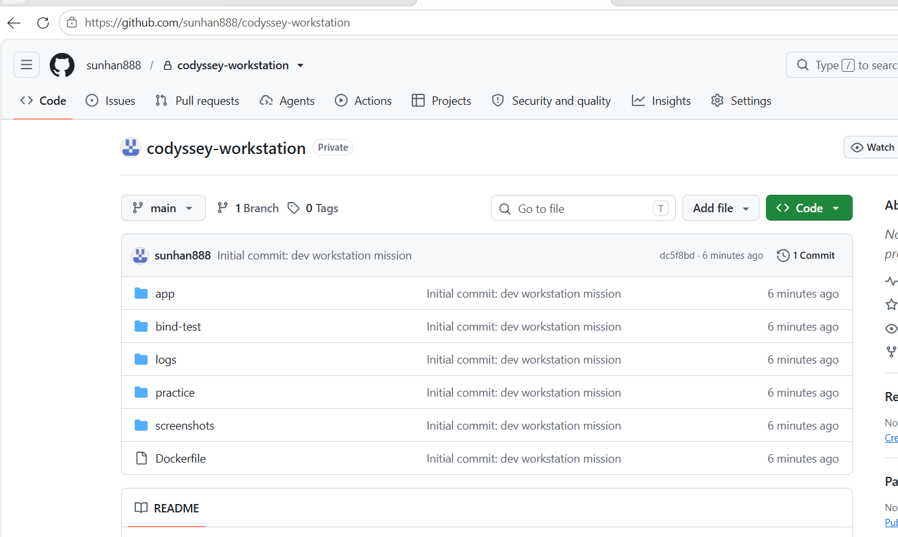

# 🐳 개발 워크스테이션 구축 미션

터미널(Linux CLI), Docker, Git/GitHub를 직접 세팅하고, **실행 결과(로그·접속·데이터 유지)로 검증**한 기록입니다.
이 문서만 읽어도 전체 수행 내용을 파악하고 같은 절차를 재현할 수 있도록 정리했습니다.

---

## 목차

1. [프로젝트 개요](#1-프로젝트-개요)
2. [실행 환경](#2-실행-환경)
3. [수행 항목 체크리스트](#3-수행-항목-체크리스트)
4. [저장소 구조](#4-저장소-구조)
5. [터미널 조작 로그](#5-터미널-조작-로그)
6. [권한 실습](#6-권한-실습)
7. [Docker 설치 및 점검](#7-docker-설치-및-점검)
8. [Docker 기본 운영 명령](#8-docker-기본-운영-명령)
9. [컨테이너 실행 실습 (hello-world, ubuntu, attach vs exec)](#9-컨테이너-실행-실습)
10. [Dockerfile 커스텀 이미지](#10-dockerfile-커스텀-이미지)
11. [포트 매핑 및 접속 증거](#11-포트-매핑-및-접속-증거)
12. [바인드 마운트 반영](#12-바인드-마운트-반영)
13. [Docker 볼륨 영속성](#13-docker-볼륨-영속성)
14. [Git 설정 및 GitHub/VS Code 연동](#14-git-설정-및-githubvs-code-연동)
15. [검증 방법 요약](#15-검증-방법-요약)
16. [트러블슈팅](#16-트러블슈팅)
17. [학습 정리 (과제 목표)](#17-학습-정리-과제-목표)
18. [재현 방법 및 주의사항](#18-재현-방법-및-주의사항)

---

## 1. 프로젝트 개요

| 항목 | 내용 |
|---|---|
| 목표 | 누구나 같은 방식으로 실행·배포·디버깅할 수 있는 재현 가능한 개발 환경 구성 |
| 핵심 도구 | Linux CLI(bash), Docker, Git/GitHub, VS Code |
| 수행 내용 | 터미널·권한 실습 → Docker 설치·운영 → Dockerfile로 웹 서버 컨테이너화 → 포트 매핑 → 바인드 마운트/볼륨 검증 → Git/GitHub 연동 |
| 검증 원칙 | 모든 단계를 명령어 + 실제 출력으로 기록 |

---

## 2. 실행 환경

| 항목 | 값 |
|---|---|
| Host OS | Windows + **WSL2** |
| Linux 배포판 | Ubuntu 26.04.1 LTS (Resolute Raccoon) |
| Kernel | 6.18.54.1-microsoft-standard-WSL2 x86_64 |
| Shell | `/bin/bash` |
| Terminal | VS Code 통합 터미널 (WSL 확장으로 Ubuntu 원격 연결) |
| Docker | Docker version 29.1.3 (Ubuntu `docker.io` 패키지, WSL 안에 Docker Engine 직접 설치) |
| Git | git version 2.53.0 |
| 작업 경로 | `/home/user9566/codyssey-workstation` |

```bash
$ whoami
user9566
$ uname -a
Linux 4F-42 6.18.54.1-microsoft-standard-WSL2 #1 SMP PREEMPT_DYNAMIC Tue Oct  6 19:13:07 UTC 2026 x86_64 GNU/Linux
$ cat /etc/os-release
PRETTY_NAME="Ubuntu 26.04.1 LTS"
NAME="Ubuntu"
VERSION_ID="26.04"
VERSION="26.04.1 LTS (Resolute Raccoon)"
...
$ echo $SHELL
/bin/bash
$ git --version
git version 2.53.0
$ docker --version
Docker version 29.1.3, build 29.1.3-0ubuntu4.1
```

> 💡 Windows PC이므로 리눅스 명령어와 파일 권한을 그대로 실습하기 위해 WSL2(Ubuntu)를 설치해 사용했습니다. 설치 과정은 [트러블슈팅 #1](#ts-1-wsl-미설치)에 있습니다.

---

## 3. 수행 항목 체크리스트

- [x] 터미널 기본 조작 (위치·목록(숨김 포함)·이동·생성·복사·이동/이름변경·삭제·내용 확인·빈 파일)
- [x] 권한 변경 실습 (파일 1개 + 디렉토리 1개, 변경 전/후 비교)
- [x] Docker 설치 및 점검 (`docker --version`, `docker info`)
- [x] Docker 운영 명령 (`images`, `ps`, `ps -a`, `logs`, `stats`, `stop`)
- [x] hello-world 실행
- [x] ubuntu 컨테이너 진입 후 명령 실행
- [x] attach vs exec 차이 관찰
- [x] Dockerfile 커스텀 이미지 빌드·실행 (nginx:alpine 기반)
- [x] 포트 매핑 접속 2회 (8080, 8081) + 브라우저 스크린샷
- [x] 바인드 마운트 반영 (호스트 변경 전/후)
- [x] Docker 볼륨 영속성 (컨테이너 삭제 전/후)
- [x] Git 사용자 정보·기본 브랜치 설정
- [x] VS Code GitHub 로그인 및 저장소 연동, push
- [x] 트러블슈팅 기록 (5건 상세 + 기타)
- [x] 민감정보 마스킹 점검

---

## 4. 저장소 구조

```
codyssey-workstation/
├── README.md                 # 기술 문서 (이 파일)
├── Dockerfile                # 커스텀 웹 서버 이미지
├── app/
│   └── index.html            # 웹 서버 정적 페이지
├── bind-test/
│   └── index.html            # 바인드 마운트 실습용 파일
├── practice/                 # 터미널·권한 실습 파일
│   ├── .secret_note          # 숨김 파일 실습
│   ├── empty.txt             # 빈 파일 실습
│   └── hello.txt
├── logs/
│   ├── docker-version.txt    # docker --version 원본 출력
│   └── docker-info.txt       # docker info 원본 출력
└── screenshots/              # 접속·연동 증거 이미지
```

---

## 5. 터미널 조작 로그

### 현재 위치 확인, 디렉토리 생성 및 이동

```bash
$ pwd
/home/user9566/codyssey-workstation
$ mkdir -p practice/docs
$ cd practice
$ pwd
/home/user9566/codyssey-workstation/practice
```

### 파일 생성 (내용 있는 파일, 빈 파일, 숨김 파일)

```bash
$ echo "hello codyssey" > hello.txt
$ touch empty.txt
$ touch .secret_note
```

### 목록 확인: `ls` vs `ls -la` (숨김 파일 포함)

```bash
$ ls
docs  empty.txt  hello.txt

$ ls -la
total 16
drwxr-xr-x 3 user9566 docker   4096 Nov  7 15:51 .
drwxr-xr-x 3 user9566 user9566 4096 Nov  7 15:50 ..
-rw-r--r-- 1 user9566 docker      0 Nov  7 15:51 .secret_note
drwxr-xr-x 2 user9566 docker   4096 Nov  7 15:50 docs
-rw-r--r-- 1 user9566 docker      0 Nov  7 15:51 empty.txt
-rw-r--r-- 1 user9566 docker     15 Nov  7 15:51 hello.txt
```

> `.`으로 시작하는 `.secret_note`는 `ls`에서는 보이지 않고 `-a` 옵션을 붙여야 보입니다.

### 파일 내용 확인 / 빈 파일 확인

```bash
$ cat hello.txt
hello codyssey
$ ls -l empty.txt
-rw-r--r-- 1 user9566 docker 0 Nov  7 15:51 empty.txt      # 크기 0 = 빈 파일
```

### 복사 → 이동 + 이름변경 → 삭제

```bash
$ cp hello.txt hello_copy.txt
$ mv hello_copy.txt docs/renamed.txt       # 이동과 이름변경을 한 번에
$ ls -la docs
total 12
drwxr-xr-x 2 user9566 docker 4096 Nov  7 16:47 .
drwxr-xr-x 3 user9566 docker 4096 Nov  7 16:47 ..
-rw-r--r-- 1 user9566 docker   15 Nov  7 15:52 renamed.txt

$ rm docs/renamed.txt
$ ls -la docs
total 8
drwxr-xr-x 2 user9566 docker 4096 Nov  7 16:52 .
drwxr-xr-x 3 user9566 docker 4096 Nov  7 16:47 ..
```

> 처음에는 `mv` 명령에 띄어쓰기 오타가 있어 실패했습니다 → [트러블슈팅 #4](#ts-4-mv-명령-실패-띄어쓰기)

### 상대경로 vs 절대경로 이동

```bash
$ cd docs                                  # 상대경로: 현재 위치(practice) 기준
$ pwd
/home/user9566/codyssey-workstation/practice/docs

$ cd ~/codyssey-workstation/practice       # 절대경로: 홈(/home/user9566)부터 전체 경로
$ pwd
/home/user9566/codyssey-workstation/practice
```

> 참고: 파일 그룹이 `docker`로 표시되는 것은 Docker 설치 후 `newgrp docker`로 기본 그룹이 바뀐 셸에서 파일을 만들었기 때문입니다.

---

## 6. 권한 실습

### 파일 권한: `hello.txt` (644 → 600 → 644)

```bash
$ ls -l hello.txt
-rw-r--r-- 1 user9566 docker 15 Nov  7 15:51 hello.txt     # 644 (변경 전)

$ chmod 600 hello.txt
$ ls -l hello.txt
-rw------- 1 user9566 docker 15 Nov  7 15:51 hello.txt     # 600: 소유자만 읽기·쓰기

$ chmod 644 hello.txt
$ ls -l hello.txt
-rw-r--r-- 1 user9566 docker 15 Nov  7 15:51 hello.txt     # 644로 복구
```

### 디렉토리 권한: `docs` (755 → 644 → 755) + 진입 실험

```bash
$ ls -ld docs
drwxr-xr-x 2 user9566 docker 4096 Nov  7 15:50 docs        # 755 (변경 전)

$ chmod 644 docs
$ ls -ld docs
drw-r--r-- 2 user9566 docker 4096 Nov  7 15:50 docs        # 644: x 권한 없음

$ cd docs
bash: cd: docs: Permission denied                           # x 없으면 진입 불가!

$ chmod 755 docs
$ ls -ld docs
drwxr-xr-x 2 user9566 docker 4096 Nov  7 15:50 docs        # 755로 복구

$ cd docs
$ pwd
/home/user9566/codyssey-workstation/practice/docs           # 진입 성공
```

| 권한 | 소유자 | 그룹 | 기타 | 의미 |
|---|---|---|---|---|
| 755 | rwx (4+2+1) | r-x (4+1) | r-x (4+1) | 디렉토리·실행 파일의 일반적 권한 |
| 644 | rw- (4+2) | r-- (4) | r-- (4) | 일반 파일의 일반적 권한 |
| 600 | rw- (4+2) | --- | --- | 나만 읽고 쓰는 개인 파일 |

> **관찰**: 디렉토리에서 `x`는 "실행"이 아니라 **"안으로 들어갈 수 있는 권한"**입니다. 644로 바꾸자 소유자도 `cd`로 진입할 수 없었습니다.

---

## 7. Docker 설치 및 점검

### 설치 (WSL Ubuntu 안에 Docker Engine 직접 설치)

```bash
$ sudo apt update
$ sudo apt install -y docker.io
...
Get:15 http://archive.ubuntu.com/ubuntu resolute-updates/universe amd64 docker.io amd64 29.1.3-0ubuntu4.1 [35.5 MB]
...
Setting up docker.io (29.1.3-0ubuntu4.1) ...
Created symlink '/etc/systemd/system/multi-user.target.wants/docker.service' → '/usr/lib/systemd/system/docker.service'.
Created symlink '/etc/systemd/system/sockets.target.wants/docker.socket' → '/usr/lib/systemd/system/docker.socket'.

$ sudo systemctl enable --now docker      # 데몬 시작 + 부팅 시 자동 실행
$ sudo usermod -aG docker $USER           # sudo 없이 docker 사용
$ newgrp docker                           # 그룹 변경 즉시 적용
```

### 버전 확인 → 원본: [`logs/docker-version.txt`](logs/docker-version.txt)

```bash
$ docker --version
Docker version 29.1.3, build 29.1.3-0ubuntu4.1
```

### 데몬 동작 확인 → 원본: [`logs/docker-info.txt`](logs/docker-info.txt)

```bash
$ docker info > logs/docker-info.txt 2>&1
$ head -20 logs/docker-info.txt
Client:
 Version:    29.1.3
 Context:    default
 Debug Mode: false
 ...
Server:
 Containers: 1
  Running: 0
  Paused: 0
  Stopped: 1
 Images: 1
 Server Version: 29.1.3
 Storage Driver: overlayfs
  driver-type: io.containerd.snapshotter.v1
 Logging Driver: json-file
 Cgroup Driver: systemd
```

> `Server:` 항목이 출력된다는 것은 클라이언트가 Docker 데몬에 정상 연결되었다는 뜻입니다.

---

## 8. Docker 기본 운영 명령

### 이미지 다운로드 및 목록

```bash
$ docker pull ubuntu
Using default tag: latest
latest: Pulling from library/ubuntu
...
Status: Downloaded newer image for ubuntu:latest

$ docker pull nginx:alpine
...
Status: Downloaded newer image for nginx:alpine

$ docker images
IMAGE                ID             DISK USAGE   CONTENT SIZE   EXTRA
hello-world:latest   c567b231f656       25.9kB         9.49kB    U
nginx:alpine         713fc2ebfd92       94.5MB         27.3MB
ubuntu:latest        6a06111c3b0a        163MB         45.9MB
```

### 컨테이너 실행 → 로그 → 리소스 → 중지

```bash
$ docker run -d --name web-test nginx:alpine
d6682765047b36b062185cbb63bbf9074a3712556f50d1ed2c61474eb59ed11f

$ docker ps
CONTAINER ID   IMAGE          COMMAND                  CREATED         STATUS         PORTS     NAMES
d6682765047b   nginx:alpine   "/docker-entrypoint.…"   4 seconds ago   Up 3 seconds   80/tcp    web-test

$ docker logs web-test
/docker-entrypoint.sh: /docker-entrypoint.d/ is not empty, will attempt to perform configuration
...
/docker-entrypoint.sh: Configuration complete; ready for start up
2026/11/07 08:22:57 [notice] 1#1: nginx/1.31.8
2026/11/07 08:22:57 [notice] 1#1: start worker processes
...

$ docker stats --no-stream
CONTAINER ID   NAME       CPU %     MEM USAGE / LIMIT     MEM %     NET I/O       BLOCK I/O         PIDS
d6682765047b   web-test   0.00%     13.36MiB / 7.577GiB   0.17%     876B / 126B   10.6MB / 8.19kB   13

$ docker stop web-test
web-test

$ docker ps -a
CONTAINER ID   IMAGE          COMMAND                  CREATED          STATUS                     PORTS   NAMES
d6682765047b   nginx:alpine   "/docker-entrypoint.…"   38 seconds ago   Exited (0) 4 seconds ago           web-test
...
```

> **관찰**: `web-test`의 PORTS가 `80/tcp`로만 표시됩니다. 컨테이너는 80번을 쓰지만 호스트와 연결(`-p`)되지 않아 외부에서 접속할 수 없는 상태입니다. → [11. 포트 매핑](#11-포트-매핑-및-접속-증거)에서 해결

---

## 9. 컨테이너 실행 실습

### hello-world

```bash
$ docker run hello-world
Unable to find image 'hello-world:latest' locally
latest: Pulling from library/hello-world
...
Status: Downloaded newer image for hello-world:latest

Hello from Docker!
This message shows that your installation appears to be working correctly.
...
```

### ubuntu 컨테이너 진입 후 명령 실행

```bash
$ docker run -it --name my-ubuntu ubuntu bash
root@ee32ee6d7ed7:/# ls
bin   dev  home  lib64  mnt  proc  run   srv  tmp  var
boot  etc  lib   media  opt  root  sbin  sys  usr
root@ee32ee6d7ed7:/# echo "hello from container"
hello from container
root@ee32ee6d7ed7:/# cat /etc/os-release | head -2
PRETTY_NAME="Ubuntu 26.04.1 LTS"
NAME="Ubuntu"
root@ee32ee6d7ed7:/# exit

$ docker ps
CONTAINER ID   IMAGE     COMMAND   CREATED   STATUS    PORTS     NAMES
$ docker ps -a
CONTAINER ID   IMAGE         COMMAND    CREATED          STATUS                      PORTS   NAMES
ee32ee6d7ed7   ubuntu        "bash"     54 seconds ago   Exited (0) 13 seconds ago           my-ubuntu
c9100ae68d5d   hello-world   "/hello"   About an hour    Exited (0) About an hour            awesome_goldstine
```

> 프롬프트가 `user9566@4F-42`에서 `root@ee32ee6d7ed7`로 바뀌면 컨테이너 내부입니다. `exit` 후에는 `docker ps`에서 사라지고 `ps -a`에만 `Exited`로 남습니다.

### attach vs exec 비교

```bash
# 백그라운드로 bash 컨테이너 실행
$ docker run -dit --name ubuntu-bg ubuntu bash
$ docker ps
CONTAINER ID   IMAGE     COMMAND   CREATED         STATUS         PORTS     NAMES
41baa6210ebd   ubuntu    "bash"    7 seconds ago   Up 7 seconds             ubuntu-bg

# ① attach 후 exit
$ docker attach ubuntu-bg
root@41baa6210ebd:/# exit
$ docker ps -a
41baa6210ebd   ubuntu   "bash"   About a minute ago   Exited (0) 14 seconds ago   ubuntu-bg   # 종료됨

# ② 다시 시작 후 exec → exit
$ docker start ubuntu-bg
$ docker exec -it ubuntu-bg bash
root@41baa6210ebd:/# echo "via exec"
via exec
root@41baa6210ebd:/# docker ps
bash: docker: command not found          # 컨테이너 안은 격리된 환경이라 docker가 없음
root@41baa6210ebd:/# exit
$ docker ps
41baa6210ebd   ubuntu   "bash"   23 minutes ago   Up 18 minutes   ubuntu-bg                 # 계속 실행 중
```

| 방법 | exit 후 컨테이너 | 이유 |
|---|---|---|
| `docker attach` | **Exited** (종료) | 컨테이너의 메인 프로세스(bash)에 직접 붙어서 그것을 끝냄 |
| `docker exec -it ... bash` | **Up** (유지) | 별도의 새 bash 프로세스를 열고 닫은 것뿐, 메인 프로세스는 그대로 |

---

## 10. Dockerfile 커스텀 이미지

**선택 방식: (A) 웹 서버 베이스 이미지 활용** — `nginx:alpine` + 정적 콘텐츠 교체 + 메타데이터·헬스체크 추가

### Dockerfile

```dockerfile
FROM nginx:alpine
LABEL org.opencontainers.image.title="my-workstation-web"
LABEL org.opencontainers.image.description="Codyssey workstation mission custom nginx"
ENV APP_ENV=dev
COPY app/ /usr/share/nginx/html
EXPOSE 80
HEALTHCHECK --interval=30s --timeout=3s CMD wget -q -O /dev/null http://127.0.0.1/ || exit 1
```

### 커스텀 포인트와 목적

| 명령 | 목적 |
|---|---|
| `FROM nginx:alpine` | 공식 nginx 이미지 중 경량(alpine) 버전을 베이스로 사용 |
| `LABEL` | 이미지 이름·설명 메타데이터 기록 (`docker inspect`로 확인 가능) |
| `ENV APP_ENV=dev` | 실행 환경 구분용 환경변수 주입 (설정과 코드 분리) |
| `COPY app/ ...` | nginx 기본 페이지를 직접 만든 `app/index.html`로 교체 |
| `EXPOSE 80` | 컨테이너가 80번을 사용한다는 문서용 표시 (실제 연결은 `-p`) |
| `HEALTHCHECK` | 30초마다 웹 서버 응답을 검사해 `healthy` / `unhealthy` 상태 표시 |

### 웹 페이지: [`app/index.html`](app/index.html)

```html
<h1>Hello, Codyssey! 🐳</h1>
<p>Dockerfile로 직접 만든 nginx 웹 서버입니다.</p>
<p>version: v1</p>
```

### 빌드

```bash
$ docker build -t my-web:1.0 .
Sending build context to Docker daemon   59.9kB
Step 1/7 : FROM nginx:alpine
 ---> 713fc2ebfd92
Step 2/7 : LABEL org.opencontainers.image.title="my-workstation-web"
 ---> Using cache
...
Step 6/7 : EXPOSE 80
 ---> Using cache
 ---> 4fd0c7561be7
Step 7/7 : HEALTHCHECK --interval=30s --timeout=3s CMD wget -q -O /dev/null http://127.0.0.1/ || exit 1
 ---> Running in 28b7673293bd
 ---> b455199005ac
Successfully built b455199005ac
Successfully tagged my-web:1.0
```

> **관찰 (레이어 캐시)**: 헬스체크 줄만 수정하고 다시 빌드하자 Step 2~6은 `Using cache`로 재사용되고 Step 7만 새로 실행되었습니다. Dockerfile의 각 명령이 하나의 레이어로 저장되기 때문입니다. → [트러블슈팅 #5](#ts-5-헬스체크가-healthy가-되지-않음)

---

## 11. 포트 매핑 및 접속 증거

같은 이미지로 호스트 포트만 다르게(8080, 8081) 두 개의 컨테이너를 실행했습니다.

```bash
$ docker run -d -p 8080:80 --name my-web-8080 my-web:1.0
$ docker run -d -p 8081:80 --name my-web-8081 my-web:1.0

$ docker ps
CONTAINER ID   IMAGE        STATUS                        PORTS                                     NAMES
7a87e55fc8fb   my-web:1.0   Up About a minute (healthy)   0.0.0.0:8081->80/tcp, [::]:8081->80/tcp   my-web-8081
7230d05f6eac   my-web:1.0   Up About a minute (healthy)   0.0.0.0:8080->80/tcp, [::]:8080->80/tcp   my-web-8080

$ docker inspect --format '{{json .State.Health.Status}}' my-web-8080
"healthy"

$ curl http://localhost:8080
<!DOCTYPE html>
<html lang="ko">
...
  <h1>Hello, Codyssey! 🐳</h1>
  <p>Dockerfile로 직접 만든 nginx 웹 서버입니다.</p>
  <p>version: v1</p>
...
$ curl http://localhost:8081
(동일한 응답)
```

### 브라우저 접속 화면 (주소창 포함)

**http://localhost:8080**



**http://localhost:8081**



> **관찰**: 컨테이너 포트는 둘 다 80번이지만 호스트 포트가 달라 충돌 없이 동시에 실행됩니다. `-p 호스트포트:컨테이너포트` 순서입니다.

---

## 12. 바인드 마운트 반영

호스트 폴더 `bind-test/`를 nginx 웹 루트에 직접 연결했습니다.

```bash
$ mkdir -p bind-test
$ echo "<h1>Bind Mount v1</h1>" > bind-test/index.html
$ docker run -d -p 8082:80 --name bind-web -v $(pwd)/bind-test:/usr/share/nginx/html nginx:alpine

# 변경 전
$ curl http://localhost:8082
<h1>Bind Mount v1</h1>

# 호스트에서 파일 수정 (컨테이너 재시작 없음)
$ echo "<h1>Bind Mount v2 - changed on host</h1>" > bind-test/index.html

# 변경 후
$ curl http://localhost:8082
<h1>Bind Mount v2 - changed on host</h1>
$ docker exec bind-web cat /usr/share/nginx/html/index.html
<h1>Bind Mount v2 - changed on host</h1>
```

> **결과**: 컨테이너를 다시 만들거나 재시작하지 않았는데 호스트의 변경이 즉시 반영되었습니다. 개발 중 코드 수정을 바로 확인할 때 유용합니다.

---

## 13. Docker 볼륨 영속성

```bash
# 볼륨 생성
$ docker volume create ws-data
ws-data
$ docker volume ls
DRIVER    VOLUME NAME
local     ws-data

# 컨테이너 1(vol-writer)에 연결해 데이터 저장
$ docker run -d --name vol-writer -v ws-data:/data ubuntu sleep infinity
$ docker exec vol-writer bash -c "echo 'saved at 2026-11-07' > /data/note.txt && cat /data/note.txt"
saved at 2026-11-07

# 컨테이너 삭제
$ docker rm -f vol-writer
vol-writer
$ docker ps -a          # 목록에 vol-writer 없음 (삭제 확인)

# 새 컨테이너 2(vol-reader)에 같은 볼륨 연결
$ docker run -d --name vol-reader -v ws-data:/data ubuntu sleep infinity
$ docker exec vol-reader cat /data/note.txt
saved at 2026-11-07     # 데이터 유지!

$ docker volume inspect ws-data
[
    {
        "CreatedAt": "2026-11-07T17:49:43+09:00",
        "Driver": "local",
        "Mountpoint": "/var/lib/docker/volumes/ws-data/_data",
        "Name": "ws-data",
        "Scope": "local"
    }
]
```

> **결과**: 데이터를 쓴 컨테이너를 삭제했지만, 볼륨은 컨테이너와 별개로 Docker가 관리하는 공간(`/var/lib/docker/volumes/...`)에 남아 있어 새 컨테이너에서 그대로 읽혔습니다.

| 구분 | 바인드 마운트 | 볼륨 |
|---|---|---|
| 저장 위치 | 내가 지정한 호스트 경로 | Docker가 관리하는 경로 |
| 주 용도 | 개발 중 코드·설정 즉시 반영 | DB 등 데이터 영속 보관 |
| 생성 | 호스트 폴더만 있으면 됨 | `docker volume create` |

---

## 14. Git 설정 및 GitHub/VS Code 연동

### Git 설정

```bash
$ git config --global user.name "sunhan888"
$ git config --global user.email "s*******@naver.com"     # 마스킹
$ git config --global init.defaultBranch main

$ git config --list
user.name=sunhan888
user.email=s*******@naver.com
init.defaultbranch=main
core.repositoryformatversion=0
core.filemode=true
core.bare=false
core.logallrefupdates=true
remote.origin.url=https://github.com/sunhan888/codyssey-workstation.git
remote.origin.fetch=+refs/heads/*:refs/remotes/origin/*
branch.main.remote=origin
branch.main.merge=refs/heads/main
```

### 로컬 저장소 생성 및 첫 커밋

```bash
$ git init
$ git add .
$ git commit -m "Initial commit: dev workstation mission"
[main (root-commit) dc5f8bd] Initial commit: dev workstation mission
 10 files changed, 78 insertions(+)
 create mode 100644 Dockerfile
 create mode 100644 app/index.html
 ...
```

### VS Code에서 GitHub 로그인 → Publish Branch → push 확인

```bash
$ git remote -v
origin  https://github.com/sunhan888/codyssey-workstation.git (fetch)
origin  https://github.com/sunhan888/codyssey-workstation.git (push)

$ git status
On branch main
Your branch is up to date with 'origin/main'.
nothing to commit, working tree clean

$ git log --oneline
dc5f8bd (HEAD -> main, origin/main) Initial commit: dev workstation mission
```

**VS Code GitHub 로그인 상태**



**GitHub 저장소 페이지**



---

## 15. 검증 방법 요약

| 검증 대상 | 사용 명령 | 확인한 것 | 결과 위치 |
|---|---|---|---|
| 숨김 파일 | `ls` vs `ls -la` | `.secret_note`가 `-a`에서만 보임 | [5장](#5-터미널-조작-로그) |
| 파일 권한 | `chmod 600/644` + `ls -l` | `-rw-------` ↔ `-rw-r--r--` | [6장](#6-권한-실습) |
| 디렉토리 권한 | `chmod 644/755` + `cd` | x 없으면 `Permission denied` | [6장](#6-권한-실습) |
| Docker 설치 | `docker --version` | 29.1.3 | [logs/docker-version.txt](logs/docker-version.txt) |
| 데몬 동작 | `docker info` | `Server:` 정보 출력 | [logs/docker-info.txt](logs/docker-info.txt) |
| 설치 동작 | `docker run hello-world` | `Hello from Docker!` | [9장](#9-컨테이너-실행-실습) |
| attach/exec | `docker ps -a` | attach 후 Exited / exec 후 Up | [9장](#attach-vs-exec-비교) |
| 커스텀 이미지 | `docker build`, `docker images` | `my-web:1.0` 생성 | [10장](#10-dockerfile-커스텀-이미지) |
| 헬스체크 | `docker ps`, `docker inspect` | `(healthy)` | [11장](#11-포트-매핑-및-접속-증거) |
| 포트 매핑 | `curl`, 브라우저 | 8080/8081 모두 응답 | [screenshots/](screenshots) |
| 바인드 마운트 | `curl` 변경 전/후 | v1 → v2 즉시 반영 | [12장](#12-바인드-마운트-반영) |
| 볼륨 영속성 | `rm -f` 전/후 `cat` | 삭제 후에도 데이터 유지 | [13장](#13-docker-볼륨-영속성) |
| GitHub 연동 | `git remote -v`, `git status` | `up to date with 'origin/main'` | [14장](#14-git-설정-및-githubvs-code-연동) |

---

## 16. 트러블슈팅

### TS-1. WSL 미설치

| 단계 | 내용 |
|---|---|
| 문제 | Windows PowerShell에서는 `chmod` 등 리눅스 권한 실습이 불가능 |
| 원인 가설 | 리눅스 환경(WSL)이 설치되어 있지 않음 |
| 확인 | `wsl --status` → "Linux용 Windows 하위 시스템 설치되어 있지 않습니다" |
| 해결 | `wsl.exe --install` (VirtualMachinePlatform 기능 활성화) → 재부팅 → `wsl --install -d Ubuntu` → 리눅스 계정 생성 |

### TS-2. VS Code 터미널/소스 제어가 Windows 기준으로 동작

| 단계 | 내용 |
|---|---|
| 문제 | ① 터미널이 `PS ...\\wsl.localhost\Ubuntu\home\...>`(PowerShell)로 열림 ② 소스 제어 패널에 "Download Git for Windows" 표시 |
| 원인 가설 | VS Code가 WSL에 원격 연결되지 않고 Windows 쪽에서 리눅스 폴더를 열고 있음 |
| 확인 | Ubuntu에는 `git version 2.53.0`이 있는데 VS Code는 Windows용 Git을 찾음 |
| 해결 | VS Code **WSL 확장** 설치 → `WSL: Connect to WSL`로 연결 후 `/home/user9566/codyssey-workstation` 열기 → bash 터미널과 Git 연동 정상화, Publish Branch 성공 |

> 같은 이유로 작업 폴더도 `/mnt/c/...`(Windows 드라이브)가 아니라 리눅스 홈(`~`) 아래에 만들었습니다. Windows 드라이브에서는 `chmod` 권한 변경이 제대로 반영되지 않습니다.

### TS-3. `docker: command not found` / `newgrp: command not found`

| 단계 | 내용 |
|---|---|
| 문제 | ① `docker --version` → `docker: command not found` ② 설치 후 `newgrp docker` → `Command 'newgrp' not found` |
| 원인 가설 | ① Ubuntu 안에 Docker 미설치 ② Ubuntu 26.04 기본 설치에 `newgrp`가 빠져 있음 |
| 확인 | 에러 메시지에 `sudo apt install util-linux-extra` 안내가 함께 출력됨 |
| 해결 | `sudo apt install -y docker.io` → `systemctl enable --now docker` → `usermod -aG docker $USER` → `sudo apt install -y util-linux-extra` → `newgrp docker` |
| 추가 발견 | `newgrp`는 새 셸을 여는 명령이라 여러 줄을 한 번에 붙여넣으면 뒤 명령이 실행되지 않음 → 단독 실행 후 다음 명령 입력 |

### TS-4. mv 명령 실패 (띄어쓰기)

| 단계 | 내용 |
|---|---|
| 문제 | `mv hello_copy.txt docs/renamed .txt` → `mv: target '.txt': No such file or directory` |
| 원인 가설 | 쉘은 **띄어쓰기로 인자를 구분**하므로, `docs/renamed`와 `.txt`가 별개 인자로 해석되어 "두 파일을 `.txt` 폴더로 이동"하라는 명령이 됨 |
| 확인 | `ls -la` → `hello_copy.txt`가 원래 위치에 그대로 남아 있음, `rm docs/renamed.txt` → No such file |
| 해결 | `mv hello_copy.txt docs/renamed.txt` → `ls -la docs`에서 `renamed.txt` 확인 |

> 같은 원인의 실수: `cd..` → command not found (`cd ..`로 해결), `exec -it ubuntu-bg bash` → bash 내장 `exec` 실행 (`docker exec`로 해결). **Tab 자동완성**과 **↑ 방향키**로 오타를 줄일 수 있습니다.

### TS-5. 헬스체크가 healthy가 되지 않음

| 단계 | 내용 |
|---|---|
| 문제 | 컨테이너 실행 1분이 지나도 STATUS가 `(health: starting)`에 머무름 |
| 원인 가설 | 헬스체크 명령 자체가 실패하고 있음 |
| 확인 | 빌드 로그 Step 7에 `wget -q -0` → 출력 옵션 `-O`(대문자 O) 대신 **숫자 0**이 입력됨 |
| 해결 | Dockerfile을 `-O`로 수정 → `docker rm -f my-web-8080 my-web-8081` → 재빌드 → 재실행 → 약 40초 후 `(healthy)`, `docker inspect` → `"healthy"` |

### 기타

- 스크린샷 파일이 `port-8080.png.png`로 저장됨 → Windows가 확장자를 숨겨서 `.png`가 중복 → `mv`로 이름 수정
- `docker build` 시 `DEPRECATED: The legacy builder is deprecated` 경고 → buildx 플러그인 미설치 안내로, 빌드 결과에는 영향 없음

---

## 17. 학습 정리 (과제 목표)

**절대경로 vs 상대경로**
절대경로는 최상위 `/`부터 전체 위치를 적는 방식(`/home/user9566/codyssey-workstation/practice`)으로 어디서 실행해도 같은 곳을 가리킵니다. 상대경로는 현재 위치를 기준으로 적는 방식(`docs`, `../`)으로, 같은 명령이라도 현재 위치에 따라 가리키는 곳이 달라집니다.

**파일 권한 (r/w/x, 755, 644)**
권한은 소유자/그룹/기타 3묶음으로 나뉘고 r=4, w=2, x=1의 합으로 표기합니다. 755는 rwx/r-x/r-x, 644는 rw-/r--/r--입니다. 디렉토리의 x는 진입 권한이라, 644로 바꾸면 `cd`가 거부되는 것을 직접 확인했습니다.

**커스텀 이미지**
기존 이미지(`nginx:alpine`)를 `FROM`으로 가져와 그 위에 내 콘텐츠(`COPY`)와 설정(`LABEL`, `ENV`, `HEALTHCHECK`)을 레이어로 쌓아 새 이미지(`my-web:1.0`)를 만들었습니다.

**포트 매핑이 필요한 이유**
컨테이너는 호스트와 격리된 네트워크에서 실행되므로, 외부(브라우저)에서 접속하려면 `-p 호스트포트:컨테이너포트`로 연결 통로를 열어야 합니다. `EXPOSE`만으로는 접속되지 않습니다.

**Docker 볼륨**
컨테이너 내부 데이터는 컨테이너를 삭제하면 함께 사라집니다. 볼륨은 Docker가 관리하는 별도 저장소라 컨테이너를 지워도 남고, 새 컨테이너에 다시 연결해 같은 데이터를 쓸 수 있습니다.

**Git vs GitHub**
Git은 내 컴퓨터에서 변경 이력을 관리하는 **도구**(add → commit)이고, GitHub는 그 저장소를 원격에 올려(push) 공유·협업하는 **플랫폼**입니다.

---

## 18. 재현 방법 및 주의사항

### 평가자 재현 절차

```bash
git clone https://github.com/sunhan888/codyssey-workstation.git
cd codyssey-workstation

# 커스텀 이미지 빌드 및 포트 매핑 실행
docker build -t my-web:1.0 .
docker run -d -p 8080:80 --name my-web-8080 my-web:1.0
curl http://localhost:8080

# 바인드 마운트
docker run -d -p 8082:80 --name bind-web -v $(pwd)/bind-test:/usr/share/nginx/html nginx:alpine
curl http://localhost:8082

# 볼륨 영속성
docker volume create ws-data
docker run -d --name vol-writer -v ws-data:/data ubuntu sleep infinity
docker exec vol-writer bash -c "echo 'test' > /data/note.txt"
docker rm -f vol-writer
docker run -d --name vol-reader -v ws-data:/data ubuntu sleep infinity
docker exec vol-reader cat /data/note.txt
```

### 환경별 주의사항

- **Windows**: WSL2 + Ubuntu 설치 후, 작업 폴더는 `/mnt/c/...`가 아닌 리눅스 홈(`~`)에 두어야 권한 실습이 정상 동작합니다. VS Code는 WSL 확장으로 연결해야 합니다.
- **macOS (서울캠퍼스 등 sudo 제한 환경)**: Docker 설치 대신 OrbStack 앱을 실행하면 동일한 `docker` 명령을 사용할 수 있습니다.
- **Linux에서 `newgrp`가 없을 때**: `sudo apt install -y util-linux-extra` 또는 로그아웃 후 재로그인으로 docker 그룹을 적용합니다.
- **포트 충돌**: 8080~8082가 이미 사용 중이면 `-p` 앞쪽(호스트 포트)만 다른 번호로 바꿔 실행합니다.

### 보안

- 비밀번호, 토큰, 개인키, 인증 코드는 문서·로그·스크린샷에 포함하지 않았습니다.
- Git 이메일은 문서에서 마스킹 처리했습니다.
- GitHub 인증은 VS Code 로그인(브라우저 OAuth)으로 진행해 토큰을 직접 다루지 않았습니다.
