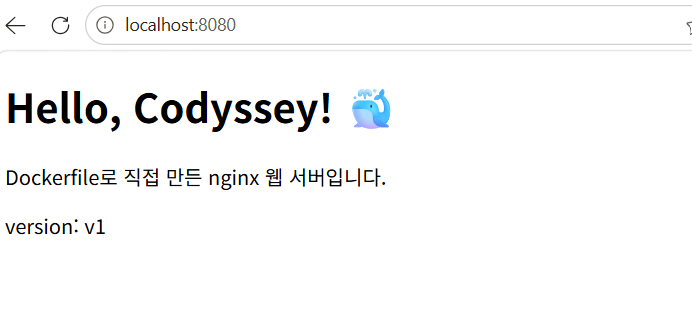
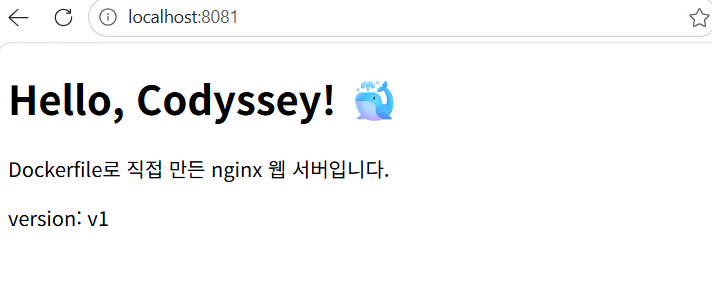
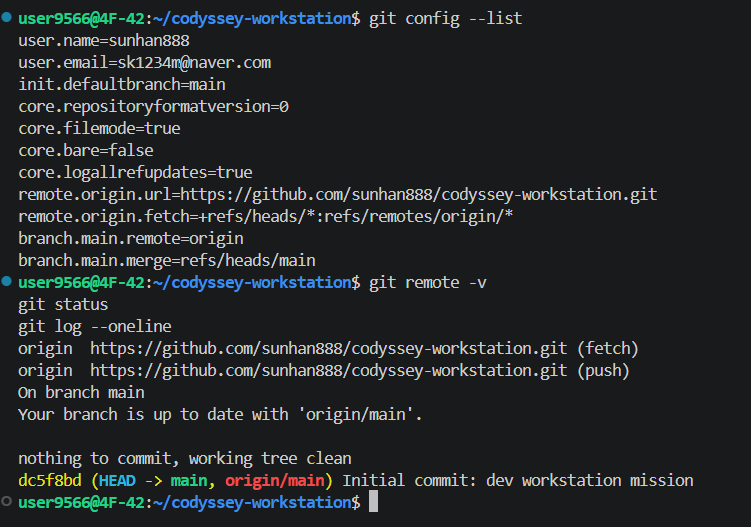
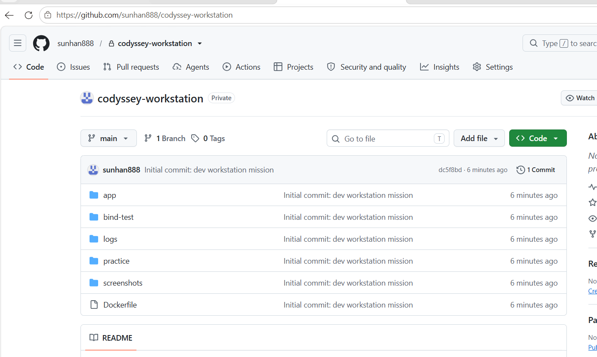

# 개발 워크스테이션 구축 미션

터미널, Docker, Git/GitHub를 직접 세팅하고 명령어와 실제 출력으로 검증한 기록입니다.
모든 장은 같은 순서로 적었습니다. **무엇을 확인하려 했는지 → 명령과 출력 → 알게 된 것.**

## 1. 개요

누가 어디서 실행해도 같은 결과가 나오는 개발 환경을 만드는 것이 목표입니다.
터미널로 파일과 권한을 다루고, Docker로 웹 서버를 컨테이너로 만들어 실행하고, Git/GitHub로 기록을 올렸습니다.

## 2. 실행 환경

| 항목 | 값 |
|---|---|
| OS | Windows + WSL2 (Ubuntu 26.04.1 LTS) |
| 쉘 / 터미널 | bash / VS Code 통합 터미널 (WSL 확장으로 연결) |
| Docker | 29.1.3 (WSL Ubuntu 안에 직접 설치) |
| Git | 2.53.0 |
| 작업 경로 | `/home/user9566/codyssey-workstation` |

```bash
$ echo $SHELL
/bin/bash
$ git --version
git version 2.53.0
$ docker --version
Docker version 29.1.3, build 29.1.3-0ubuntu4.1
```

## 3. 체크리스트와 검증 방법

| 완료 | 항목 | 확인한 명령 | 확인한 것 | 위치 |
|:-:|---|---|---|---|
| ✅ | 터미널 조작 | `pwd` `ls -la` `cd` `cp` `mv` `rm` `cat` `touch` | 숨김 파일은 `-a`에서만 보임 | [4장](#4-터미널-조작) |
| ✅ | 권한 | `chmod` + `ls -l` | 변경 전후 표기, x 없는 폴더는 진입 불가 | [5장](#5-권한) |
| ✅ | Docker 설치·점검 | `docker --version` `docker info` | 버전, 데몬 연결 | [6장](#6-docker-설치와-운영) |
| ✅ | Docker 운영 | `images` `ps` `ps -a` `logs` `stats` | 이미지·컨테이너 상태 | [6장](#6-docker-설치와-운영) |
| ✅ | 컨테이너 실습 | `docker run` `attach` `exec` | attach 후 종료, exec 후 유지 | [7장](#7-컨테이너-실습) |
| ✅ | Dockerfile | `docker build` | `my-web:1.0` 생성 | [8장](#8-커스텀-이미지) |
| ✅ | 포트 매핑 | `curl`, 브라우저 | 8080, 8081 접속 | [9장](#9-포트-매핑) |
| ✅ | 바인드 마운트 | `curl` 변경 전후 | 호스트 수정이 즉시 반영 | [10장](#10-바인드-마운트) |
| ✅ | 볼륨 | 컨테이너 삭제 전후 `cat` | 삭제 후에도 데이터 유지 | [11장](#11-볼륨-영속성) |
| ✅ | Git / GitHub | `git config --list` `git remote -v` | 설정, 원격 연동, push | [12장](#12-git과-github) |

## 4. 터미널 조작

**확인하려는 것:** 위치 확인, 목록, 이동, 생성, 복사, 이름 변경, 삭제를 터미널로 할 수 있다.

```bash
$ pwd
/home/user9566/codyssey-workstation
$ mkdir -p practice/docs
$ cd practice

$ echo "hello codyssey" > hello.txt     # 내용 있는 파일
$ touch empty.txt                       # 빈 파일
$ touch .secret_note                    # 숨김 파일

$ ls
docs  empty.txt  hello.txt

$ ls -la
drwxr-xr-x 3 user9566 docker   4096 Nov  7 15:51 .
drwxr-xr-x 3 user9566 user9566 4096 Nov  7 15:50 ..
-rw-r--r-- 1 user9566 docker      0 Nov  7 15:51 .secret_note
drwxr-xr-x 2 user9566 docker   4096 Nov  7 15:50 docs
-rw-r--r-- 1 user9566 docker      0 Nov  7 15:51 empty.txt
-rw-r--r-- 1 user9566 docker     15 Nov  7 15:51 hello.txt

$ cat hello.txt
hello codyssey

$ cp hello.txt hello_copy.txt
$ mv hello_copy.txt docs/renamed.txt    # 이동과 이름 변경을 한 번에
$ ls docs
renamed.txt
$ rm docs/renamed.txt
```

상대 경로와 절대 경로로 각각 이동해 보았습니다.

```bash
$ cd docs                                                 # 상대 경로: 지금 위치(practice) 기준
$ pwd
/home/user9566/codyssey-workstation/practice/docs

$ cd /home/user9566/codyssey-workstation/practice         # 절대 경로: / 부터 전부
$ pwd
/home/user9566/codyssey-workstation/practice
```

**알게 된 것:** `.`으로 시작하는 파일은 `ls -a`를 써야 보입니다. 절대 경로는 어디서 쳐도 같은 곳으로 가고, 상대 경로는 지금 위치에 따라 달라집니다.

## 5. 권한

**확인하려는 것:** `chmod`로 권한을 바꾸면 표기와 동작이 어떻게 달라지는가.

파일 `hello.txt` (644 → 600 → 644)

```bash
$ ls -l hello.txt
-rw-r--r-- 1 user9566 docker 15 Nov  7 15:51 hello.txt     # 변경 전 644
$ chmod 600 hello.txt
$ ls -l hello.txt
-rw------- 1 user9566 docker 15 Nov  7 15:51 hello.txt     # 600: 소유자만 읽기·쓰기
$ chmod 644 hello.txt                                      # 복구
```

폴더 `docs` (755 → 644 → 755)

```bash
$ ls -ld docs
drwxr-xr-x 2 user9566 docker 4096 Nov  7 15:50 docs        # 변경 전 755
$ chmod 644 docs
$ ls -ld docs
drw-r--r-- 2 user9566 docker 4096 Nov  7 15:50 docs        # x 없음
$ cd docs
bash: cd: docs: Permission denied
$ chmod 755 docs                                           # 복구
$ cd docs                                                  # 진입 성공
```

| 숫자 | 소유자 | 그룹 | 그 외 |
|---|---|---|---|
| 755 | rwx (4+2+1) | r-x (4+1) | r-x (4+1) |
| 644 | rw- (4+2) | r-- (4) | r-- (4) |
| 600 | rw- (4+2) | --- | --- |

**알게 된 것:** 숫자 한 자리는 r=4, w=2, x=1의 합입니다. 폴더에서 x는 안으로 들어가는 권한이라, x를 빼자 주인인 나도 `cd`가 거부됐습니다.

## 6. Docker 설치와 운영

**확인하려는 것:** Docker가 설치되어 있고, 데몬이 동작하며, 기본 운영 명령을 쓸 수 있다.

```bash
$ docker --version
Docker version 29.1.3, build 29.1.3-0ubuntu4.1

$ docker info
Client:
 Version:    29.1.3
 ...
Server:
 Containers: 1
 Images: 1
 Server Version: 29.1.3
 ...
```

원본 출력: [`logs/docker-version.txt`](logs/docker-version.txt), [`logs/docker-info.txt`](logs/docker-info.txt)

```bash
$ docker pull nginx:alpine
Status: Downloaded newer image for nginx:alpine

$ docker images
IMAGE                ID             DISK USAGE   CONTENT SIZE
hello-world:latest   c567b231f656       25.9kB         9.49kB
nginx:alpine         713fc2ebfd92       94.5MB         27.3MB
ubuntu:latest        6a06111c3b0a        163MB         45.9MB

$ docker run -d --name web-test nginx:alpine
$ docker ps
CONTAINER ID   IMAGE          STATUS         PORTS     NAMES
d6682765047b   nginx:alpine   Up 3 seconds   80/tcp    web-test

$ docker logs web-test
/docker-entrypoint.sh: Configuration complete; ready for start up
2026/11/07 08:22:57 [notice] 1#1: nginx/1.31.8
...

$ docker stats --no-stream
NAME       CPU %     MEM USAGE / LIMIT     MEM %
web-test   0.00%     13.36MiB / 7.577GiB   0.17%

$ docker stop web-test
$ docker ps -a
CONTAINER ID   IMAGE          STATUS                     NAMES
d6682765047b   nginx:alpine   Exited (0) 4 seconds ago   web-test
```

**알게 된 것:** `docker info`에 `Server:` 항목이 나오면 데몬에 연결된 것입니다. `docker ps`는 실행 중인 컨테이너만, `docker ps -a`는 멈춘 것까지 보여줍니다.

## 7. 컨테이너 실습

**확인하려는 것:** 컨테이너는 언제 종료되고 언제 유지되는가.

```bash
$ docker run hello-world
Hello from Docker!
This message shows that your installation appears to be working correctly.

$ docker run -it --name my-ubuntu ubuntu bash
root@ee32ee6d7ed7:/# ls
bin   dev  home  lib64  mnt  proc  run   srv  tmp  var ...
root@ee32ee6d7ed7:/# echo "hello from container"
hello from container
root@ee32ee6d7ed7:/# exit

$ docker ps -a
CONTAINER ID   IMAGE         COMMAND    STATUS                      NAMES
ee32ee6d7ed7   ubuntu        "bash"     Exited (0) 13 seconds ago   my-ubuntu
c9100ae68d5d   hello-world   "/hello"   Exited (0) About an hour    awesome_goldstine
```

attach와 exec 비교

```bash
$ docker run -dit --name ubuntu-bg ubuntu bash

$ docker attach ubuntu-bg
root@41baa6210ebd:/# exit
$ docker ps -a
41baa6210ebd   ubuntu   "bash"   Exited (0) 14 seconds ago   ubuntu-bg     # 종료됨

$ docker start ubuntu-bg
$ docker exec -it ubuntu-bg bash
root@41baa6210ebd:/# exit
$ docker ps
41baa6210ebd   ubuntu   "bash"   Up 18 minutes   ubuntu-bg                 # 계속 실행 중
```

**알게 된 것:** 컨테이너는 처음 시작한 프로그램(메인 프로세스)이 살아 있는 동안만 실행됩니다. `attach`는 그 메인 bash에 붙는 것이라 exit 하면 컨테이너도 멈춥니다. `exec`는 bash를 하나 더 띄우는 것이라 exit 해도 컨테이너는 유지됩니다.

## 8. 커스텀 이미지

**확인하려는 것:** 기존 이미지 위에 내 변경을 얹어 새 이미지를 만들 수 있다.

선택한 방식은 (A) 웹 서버 베이스 이미지 활용이고, 베이스는 `nginx:alpine`입니다.

```dockerfile
FROM nginx:alpine
LABEL org.opencontainers.image.title="my-workstation-web"
LABEL org.opencontainers.image.description="Codyssey workstation mission custom nginx"
ENV APP_ENV=dev
COPY app/ /usr/share/nginx/html
EXPOSE 80
HEALTHCHECK --interval=30s --timeout=3s CMD wget -q -O /dev/null http://127.0.0.1/ || exit 1
```

| 줄 | 목적 |
|---|---|
| `FROM` | 이미 만들어진 nginx 이미지를 출발점으로 사용 |
| `LABEL` | 이미지 이름과 설명을 기록 |
| `ENV` | 실행 환경을 구분하는 설정값 주입 |
| `COPY` | nginx 기본 페이지를 내 [`app/index.html`](app/index.html)로 교체 |
| `EXPOSE` | 80번 포트를 쓴다는 안내. 실제 연결은 `-p`로 한다 |
| `HEALTHCHECK` | 30초마다 웹 서버가 응답하는지 검사 |

```bash
$ docker build -t my-web:1.0 .
Step 1/7 : FROM nginx:alpine
...
Step 7/7 : HEALTHCHECK --interval=30s --timeout=3s CMD wget -q -O /dev/null http://127.0.0.1/ || exit 1
Successfully built b455199005ac
Successfully tagged my-web:1.0
```

## 9. 포트 매핑

**확인하려는 것:** `-p`로 연결해야 호스트에서 컨테이너의 웹 서버에 접속할 수 있다.

```bash
$ docker run -d -p 8080:80 --name my-web-8080 my-web:1.0
$ docker run -d -p 8081:80 --name my-web-8081 my-web:1.0

$ docker ps
IMAGE        STATUS                        PORTS                    NAMES
my-web:1.0   Up About a minute (healthy)   0.0.0.0:8081->80/tcp     my-web-8081
my-web:1.0   Up About a minute (healthy)   0.0.0.0:8080->80/tcp     my-web-8080

$ curl http://localhost:8080
  <h1>Hello, Codyssey! 🐳</h1>
  <p>Dockerfile로 직접 만든 nginx 웹 서버입니다.</p>
```





**알게 된 것:** 순서는 `-p 호스트포트:컨테이너포트`입니다. 6장의 `web-test`는 `-p` 없이 실행해서 PORTS가 `80/tcp`뿐이었고 접속할 길이 없었습니다. 컨테이너 쪽은 둘 다 80번이지만 호스트 포트가 달라서 동시에 실행됩니다.

## 10. 바인드 마운트

**확인하려는 것:** 호스트 폴더를 연결하면 호스트에서 고친 내용이 컨테이너에 바로 보인다.

```bash
$ echo "<h1>Bind Mount v1</h1>" > bind-test/index.html
$ docker run -d -p 8082:80 --name bind-web -v $(pwd)/bind-test:/usr/share/nginx/html nginx:alpine

$ curl http://localhost:8082                                             # 변경 전
<h1>Bind Mount v1</h1>

$ echo "<h1>Bind Mount v2 - changed on host</h1>" > bind-test/index.html   # 호스트에서 수정

$ curl http://localhost:8082                                             # 변경 후
<h1>Bind Mount v2 - changed on host</h1>
```

**알게 된 것:** 컨테이너를 다시 만들거나 재시작하지 않았는데 바뀌었습니다. 호스트 폴더와 컨테이너 폴더가 같은 곳이기 때문입니다.

## 11. 볼륨 영속성

**확인하려는 것:** 볼륨에 쓴 데이터는 컨테이너를 삭제해도 남는다.

```bash
$ docker volume create ws-data

# 컨테이너 1에서 볼륨에 쓰기
$ docker run -d --name vol-writer -v ws-data:/data ubuntu sleep infinity
$ docker exec vol-writer bash -c "echo 'saved at 2026-11-07' > /data/note.txt && cat /data/note.txt"
saved at 2026-11-07

# 컨테이너 1 삭제
$ docker rm -f vol-writer

# 컨테이너 2에 같은 볼륨을 연결해 읽기
$ docker run -d --name vol-reader -v ws-data:/data ubuntu sleep infinity
$ docker exec vol-reader cat /data/note.txt
saved at 2026-11-07
```

**알게 된 것:** 파일을 쓴 컨테이너는 사라졌는데 다른 컨테이너에서 같은 파일이 읽혔습니다. 데이터가 컨테이너가 아니라 볼륨에 저장되어 있었다는 뜻입니다.

| | 바인드 마운트 | 볼륨 |
|---|---|---|
| 저장 위치 | 내가 지정한 호스트 폴더 | Docker가 관리하는 공간 |
| 주로 쓰는 때 | 개발 중 수정 내용을 바로 반영 | 데이터를 오래 보관 |

## 12. Git과 GitHub

**확인하려는 것:** Git 설정을 마치고, 로컬 커밋을 GitHub에 올릴 수 있다.

```bash
$ git config --global user.name "sunhan888"
$ git config --global user.email "s*******@naver.com"     # 문서에서는 마스킹
$ git config --global init.defaultBranch main

$ git config --list
user.name=sunhan888
user.email=s*******@naver.com
init.defaultbranch=main
remote.origin.url=https://github.com/sunhan888/codyssey-workstation.git
branch.main.remote=origin
...

$ git init
$ git add .
$ git commit -m "Initial commit: dev workstation mission"
[main (root-commit) dc5f8bd] Initial commit: dev workstation mission

$ git status
On branch main
Your branch is up to date with 'origin/main'.
```

VS Code에서 GitHub에 로그인한 뒤 Publish Branch로 올렸습니다.





**알게 된 것:** `add`와 `commit`은 내 컴퓨터의 Git에서 일어나고, push를 해야 GitHub에 올라갑니다.

## 13. 트러블슈팅

### 1) VS Code가 Windows 기준으로 동작함

| 단계 | 내용 |
|---|---|
| 문제 | 터미널이 PowerShell로 열리고, 소스 제어 패널에 "Download Git for Windows"가 표시됨 |
| 원인 가설 | VS Code가 WSL에 연결되지 않고 Windows 쪽에서 리눅스 폴더를 열고 있다 |
| 확인 | Ubuntu에는 `git version 2.53.0`이 있는데 VS Code는 Windows용 Git을 찾고 있었음 |
| 해결 | WSL 확장을 설치하고 `WSL: Connect to WSL`로 연결한 뒤 폴더를 다시 열었음 |

### 2) `mv` 명령 실패

| 단계 | 내용 |
|---|---|
| 문제 | `mv hello_copy.txt docs/renamed .txt` → `mv: target '.txt': No such file or directory` |
| 원인 가설 | 쉘은 띄어쓰기로 인자를 나누므로 `docs/renamed`와 `.txt`가 따로 해석됐다 |
| 확인 | `ls -la`로 보니 `hello_copy.txt`가 원래 자리에 그대로 있었음 |
| 해결 | 띄어쓰기를 없애고 `mv hello_copy.txt docs/renamed.txt`로 다시 실행 |

### 3) 헬스체크가 healthy가 되지 않음

| 단계 | 내용 |
|---|---|
| 문제 | 실행 1분이 지나도 STATUS가 `(health: starting)`에 머무름 |
| 원인 가설 | 헬스체크 명령 자체가 실패하고 있다 |
| 확인 | 빌드 로그 Step 7을 보니 `wget -q -0`으로, 대문자 O 자리에 숫자 0이 들어가 있었음 |
| 해결 | Dockerfile을 `-O`로 고치고 컨테이너 삭제 → 재빌드 → 재실행. 약 40초 뒤 `(healthy)` 확인 |

## 14. 배운 점

- **절대 경로와 상대 경로** 절대 경로는 `/`부터 전부 적어서 어디서 쳐도 같은 곳을 가리킵니다. 상대 경로는 지금 위치 기준이라 위치가 바뀌면 가리키는 곳도 바뀝니다.
- **권한** 소유자, 그룹, 그 외 순서로 r=4, w=2, x=1을 더해 적습니다. 755는 rwx/r-x/r-x, 644는 rw-/r--/r--입니다.
- **커스텀 이미지** `FROM`으로 기존 이미지를 가져오고 그 위에 내 파일과 설정을 더해 새 이미지를 만들었습니다.
- **포트 매핑** 컨테이너는 호스트와 격리되어 있어서 `-p 호스트:컨테이너`로 연결해야 브라우저에서 접속됩니다.
- **볼륨** 컨테이너 안의 데이터는 컨테이너와 함께 사라집니다. 볼륨은 컨테이너 밖에 있어서 지워도 남습니다.
- **Git과 GitHub** Git은 내 컴퓨터에서 변경 이력을 남기는 도구이고, GitHub는 그 기록을 올려 공유하는 원격 서비스입니다.

## 보안

비밀번호, 토큰, 개인키, 인증 코드는 문서와 스크린샷에 넣지 않았습니다. Git 이메일은 마스킹했고, GitHub 인증은 VS Code 로그인으로 진행해 토큰을 직접 다루지 않았습니다.
